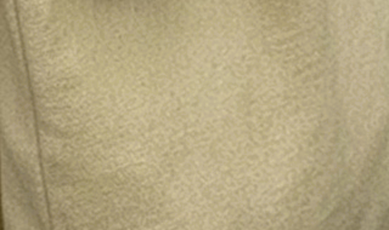
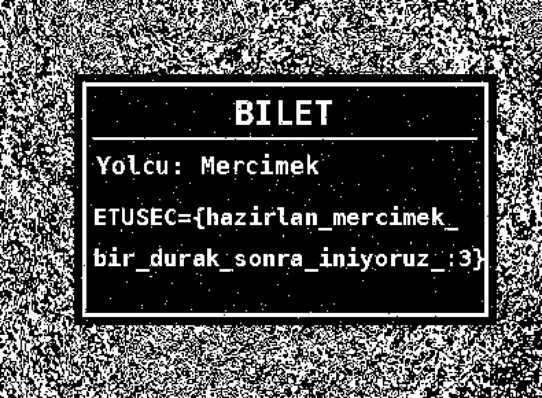

# 🕵️‍♂️ Çözüm – Mercimek ve G4 Paniği

> ⚠️ **SPOILER:** Bu dosya tüm flag'leri içerir.

Dosya: `challenge/challenge.jpg` — 3 flag, 3 farklı katman: **ham baytlar → metadata → pikseller**.

---

## 🚩 Flag 1 – Dosyanın "derinliklerine" in (ham baytlar)

Görseli bir metin düzenleyiciyle açmak yeterli.

- **Windows:** `challenge.jpg` → Birlikte aç → **Not Defteri**. İlk satırlarda görünür.
- **Linux/macOS:**
  ```bash
  strings challenge.jpg | head
  xxd challenge.jpg | head -8
  ```

```
ÿØÿï `

ETUSEC={burada_oldugunu_mu_dusundun_ayrintilara_bakmalisin}

 /\_/\
( o.o )
 > ^ <
```

**Neden orada?** Bir JPEG `FF D8` (SOI) ile başlar ve ardından segmentler gelir. Flag, SOI'den hemen sonra eklenmiş bir **APP15 (`FF EF`) segmentinin** içinde. Görüntüleyiciler tanımadıkları APPn segmentlerini atladığı için resim normal açılır, ama baytlar düz ASCII olduğu için metin olarak okunabilir.

Flag'in kendisi de bir ipucu: *"ayrıntılara bakmalısın"* → dosya **Ayrıntıları**.

```
ETUSEC={burada_oldugunu_mu_dusundun_ayrintilara_bakmalisin}
```

---

## 🚩 Flag 2 – Ayrıntılar (EXIF metadata)

- **Windows:** Sağ tık → **Özellikler** → **Ayrıntılar** → *Kamera* bölümü → **Mercek modeli**. (Mercek üreticisi: *Sirkeci* 😉)
- **Komut satırı:**
  ```bash
  exiftool challenge.jpg | grep -i lens
  # Lens Make  : Sirkeci
  # Lens Model : ETUSEC={sacmalama_cantadaki_bilete_baksana}
  ```

```
ETUSEC={sacmalama_cantadaki_bilete_baksana}
```

İpucu: *"çantadaki bilete bak"* → bu sefer piksellere bakacağız.

---

## 🚩 Flag 3 – Çantadaki gizli bilet (bit düzlemleri)

Normal bakışta çanta tamamen sıradan görünüyor:



### Bit düzlemi nedir?

Her pikselin R, G, B kanalı 0–255 arası bir sayıdır, yani 8 bit:

```
Mavi = 139  →  1 0 0 0 1 0 1 1
               7 6 5 4 3 2 1 0   ← bit numarası
```

*n*. bit düzlemi, her piksel için yalnızca `(değer >> n) & 1` bitini siyah/beyaz olarak gösterir. Yüksek bitler (7, 6) resmin kaba hatlarını, düşük bitler (0–3) ise neredeyse rastgele gürültüyü taşır. Düşük bitlere yazılan bir şekil değeri sadece birkaç seviye değiştirir; göz bunu fark etmez, ama o bit düzlemine bakınca net görünür.

Bu soruda bilet, **Mavi kanalın 3. bitine** yazıldı. Çantadaki bilet bölgesinde mavi değerler en fazla ±6 seviye oynatıldı: yazı pikselleri bit3 = 1, arka plan bit3 = 0. Değerler, JPEG sıkıştırmasından sağ çıkacak şekilde (`değer % 8 ∈ 2..5`) seçildi ve dosya kalite 100, 4:4:4 olarak kaydedildi.

### Çözüm

1. https://www.aperisolve.com/ adresine `challenge.jpg` dosyasını yükle (veya **Stegsolve** ile aç ve oklarla *Blue plane 3*'e gel).
2. **Blue – bit 3** görüntüsüne bak.
3. Çantanın üzerinde bilet belirir:



Python ile:
```bash
python3 tools/bitplanes.py challenge.jpg out/    # out/B3.png
```

```
ETUSEC={hazirlan_mercimek_bir_durak_sonra_iniyoruz_:3}
```

Mercimek doğru durakta iniyor! 🐾

---

## 📋 Özet

| # | Yer | Araç | Flag |
|---|-----|------|------|
| 1 | APP15 segmenti (dosya başı) | Not Defteri / `strings` / `xxd` | `ETUSEC={burada_oldugunu_mu_dusundun_ayrintilara_bakmalisin}` |
| 2 | EXIF `LensModel` | Özellikler › Ayrıntılar / `exiftool` | `ETUSEC={sacmalama_cantadaki_bilete_baksana}` |
| 3 | Mavi kanal, bit 3 | Aperi'Solve / Stegsolve | `ETUSEC={hazirlan_mercimek_bir_durak_sonra_iniyoruz_:3}` |
